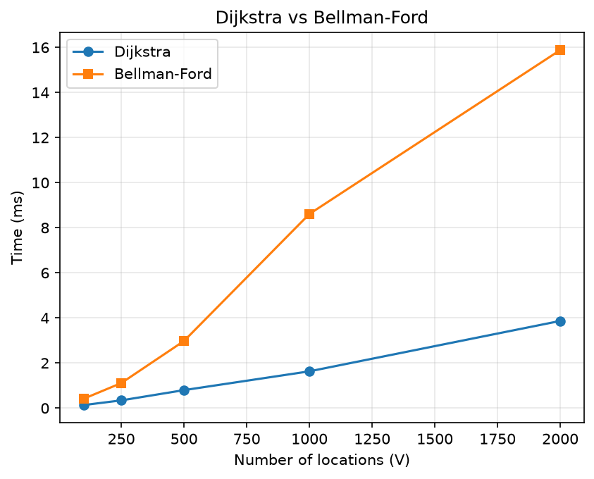

# Smart City Route Optimization System

Finds the shortest route between locations in a city. Locations are **vertices**, roads are **weighted edges** (travel time in minutes). Implements **Dijkstra** and **Bellman-Ford** and benchmarks them on graphs of increasing size.

## Project structure
| File | Purpose |
|---|---|
| `graph.py` | Graph class (adjacency list) + random connected city generator |
| `algorithms.py` | `dijkstra`, `bellman_ford`, `reconstruct_path` |
| `benchmark.py` | Runtime comparison, writes `benchmark_results.csv` and `benchmark.png` |
| `main.py` | Interactive demo on a named city map |
| `tests/` | Pytest suite (correctness, agreement, negative edges/cycles) |

## Run
```bash
pip install -r requirements.txt
python main.py        # interactive route finder
python benchmark.py   # performance comparison
python -m pytest                # run tests
```

## Complexity
| | Time | Space | Negative weights | Negative cycle detection |
|---|---|---|---|---|
| Dijkstra (binary heap) | O((V+E) log V) | O(V) | No | No |
| Bellman-Ford | O(V·E) | O(V) | Yes | Yes |

## Benchmark results (sparse graph, E ≈ 8V)
| V | E | Dijkstra (ms) | Bellman-Ford (ms) |
|---|---|---|---|
| 100 | 798 | 0.217 | 0.590 |
| 250 | 1998 | 0.521 | 1.451 |
| 500 | 3998 | 1.297 | 2.956 |
| 1000 | 7998 | 1.597 | 6.749 |
| 2000 | 15998 | 3.766 | 13.939 |



## Conclusion
Dijkstra is faster on road networks since weights (travel time) are never negative. Bellman-Ford is slower but more general: it supports negative weights (e.g. discounts or toll credits) and detects negative cycles. Both give identical distances, which the tests verify. An early-exit optimisation in Bellman-Ford stops once no distances change.

## Future work
A* search with geographic heuristics, real map data (OpenStreetMap), live traffic weights.
